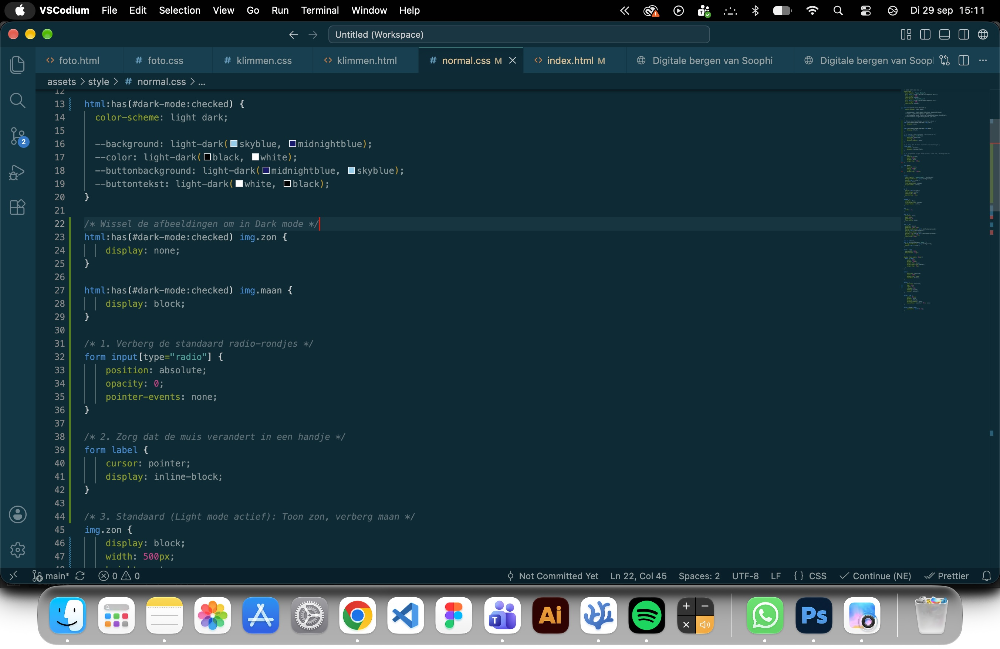
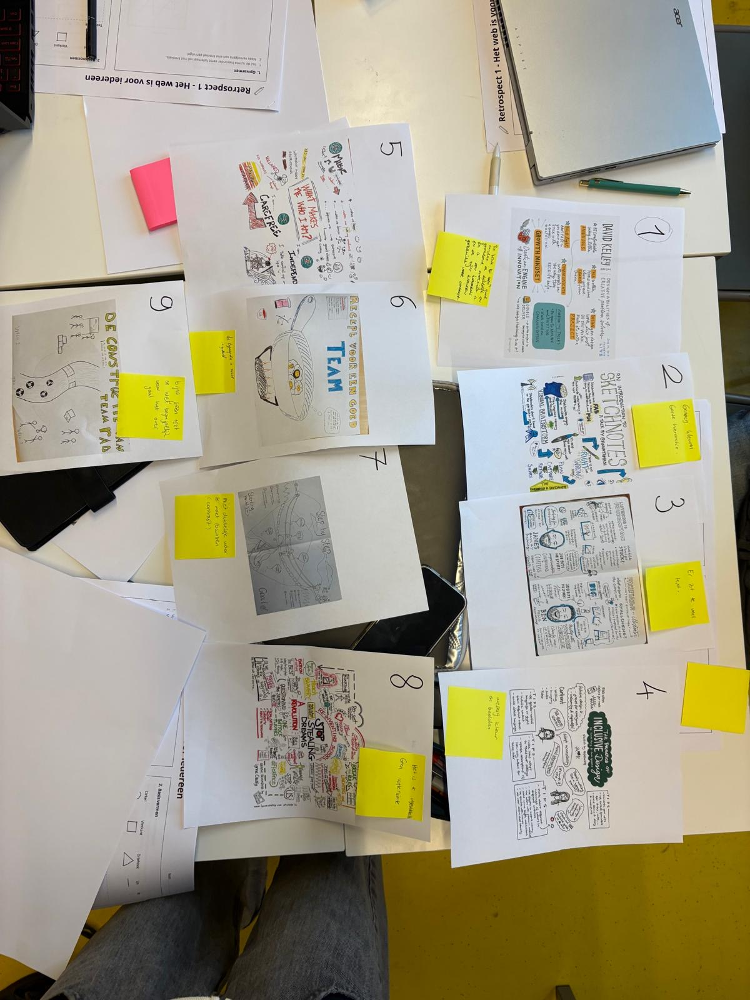

## Learning Log
### 19 okt - feedback Vasilis en Joëlle
Ik heb vandaag geleerd dat je een MARK kan schrijven in de code. Super handig, wel lekker laat. Vasilis heeft me de feedback gegeven om mijn code wat netter te organiseren. Mijn body stond bijvoorbeeld in het midden van de hele code. Dus dit heb ik gedaan. Ik heb overal marks neergezet en alles netjes gesorteert en bij elkaar gedaan. Nu kan ik het allemaal in 1 keer vinden:

Ik had gevraagd of de classes in mijn cookies wel echt nodig waren. Hierbij stelde Vasilis voor het te vervangen voor nth-of-type (Ik was even vergeten dat die mogelijkheid er was), dus dat heb ik nu aangepast.

### 17 okt - lyric uitwerken
 Bij het schrijven van deze code merk ik dat ik meer notities aan het schrijven ben en dat ik dat heel handig vind om te doen omdat ik alles makkelijker terug kan vinden en aanpassen. Bij alle vorige codes die ik heb geschreven heb ik af en toe een paar notities gezet maar is het vooral code.

 

 
 
 

Ik heb verschillende iteraties van mijn schetsen gemaakt, omdat de oorspronkelijke schets op de laptop er toch niet helemaal uitzach zoals wat ik wilde verbeelden. De vierkanten sloten visueel niet goed aan bij de rest van de compositie. Ook twijfelde ik over het toevoegen van de kleinere woorden 'voor' en 'ik'. Uiteindelijk heb ik hier bewust voor gekozen: de zin "voor ik vergeet" wordt in het nummer continu herhaald. Door alleen die twee kernwoorden subtiel te herhalen, visualiseer ik die herhaling zonder dat de volledige zin letterlijk terug hoeft te komen. Ik heb van alle tussenstappen screenshots gemaakt om de versies te vergelijken en tot de beste keuze te komen.

 
 
 
 

 
 

 

### 16 okt - nieuwe schetsen voor lyrics
Omdat ik nog erg ontevreden was met mijn lyric ontwerp heb ik heel veel nieuwe scheten gemaakt. de vorige keer had ik maar een paar schetsen gemaakt en er was weinig verandering per schets. Dit keer heb ik juist het tegenovergestelde gedaan omdat ik denk dat dat voor een beter resultaat gaat zorgen.

 Bij deze schets wilde ik een animatie koppelen aan een specifiek geluid in de muziek. In het nummer hoor je een soort fonkeling die doet denken aan twinkelende sterren. Om dit visueel te vertalen, animeer ik de woorden appart van dik naar dun. Hierdoor hoop een sterreneffect na te maken dat het geluid in de tekst versterkt en er visueel mooi uitziet.

Omdat ik veel verschillende schetsen had gemaakt en twijfelde over de juiste samenhang, heb ik mijn favorieten stukjes uitgeknipt. Door losse onderdelen handmatig te combineren en te schuiven, kon ik verschillende lay-outs en combinaties direct vergelijken. Dit gaf mij inzicht in welke combinatie het meest passend was voor de uiteindelijke uitwerking in code.

### 14 okt - cookies popup ontwerpen

 Ik heb hier verschillende tekeningen gemaakt voor mijn cookie popup. Uiteindelijk heb ik gekozen voor de paars gele popup. Ik vond die kleuren het beste bij elkaar passen en ook bij de rest van mijn website. Paars is een kleur die ik nog niet had gebruikt en ik hebruik voor elk scherm een andere kleuren combinatie. Ondanks dat er  nog geen paars in zat vond ik het wel goed passend bij de donkeren marine en groene kleuren.

Om de code van de cookies te schrijven heb ik gekeken naar de code van de deepdive. Deze heb ik aangepast tot dat mijn popup eruit zag zoals hierboven te zien is.

### feedback, check out en animatie deepdive - 9 okt
 Ik heb hier de oefeningentjes gedaan van de deep dive. Het heeft me nog geen inspiratie gegeven hoe ik het kan toepassen op mijn lyrics.

Het nummer van Spinvis vind ik een uitdagend stuk om vorm te geven. Het is een rustig nummer waarin juist de poëzie van de tekst centraal staat. Mijn eerste gevoel was daarom dat het overmatig uitvergroten van de typografiegeen goed effect zou hebben aan die subtiliteit. Tegelijkertijd ben ik nog niet tevreden met het huidige resultaat. Om het ontwerp naar een hoger niveau te brengen en nieuwe invalshoeken te ontdekken, ga ik de feedback van Vasilis volgen: juist wél bewust te gaan overdrijven. Door die overdrijvingen in vormgeving uit te proberen, wil ik onderzoeken hoe ik het nummer meer visuele expressie kan geven zonder de rustige poëzie te verliezen.

Feedback Vasilis:

Alles heel erg overdrijven in grootes en afstalden in je lyrics zodat het minder rommelig lijkt. Mischien dat het er daarna nog steeds niet goed uitziet maar het brengt vaak wel ideeën op

1. Welke variabelen van Seraphs gebruik je in de opmaak van je songtekst?

Aangepaste weight en serifs

2. Wat voegt iedere variabele toe aan je ontwerp (denk aan leesbaarheid, hiërarchie of de uitstraling die je wil bereiken)?

Ik zorg voor visuele hiërarchie en contrast door een schommelingen in dikte te maken. daarmee stuur ik de blik van de gebruiker een beetje aan. Stevige zinnen of woorden eisen als eerste de aandacht op. Door binnen 1 woord de letters groter te laten worden wil ik overbrengen dat het woord steeds hoger in toon wordt uitgesproken.

Sfeer en uitstraling: De fijnere lijnen van de dunnere letters van bepaalde woorden roepen een gevoel van rust, nuance en zachtheid op.

3. Hoe zou je animatie kunnen toepassen om het ritme of de accenten in de weergave van je songtekst nog beter visueel te maken?

Omdat het nummer subtiele melodische modulaties en toonhoogteverschillen heeft die niet plotseling omslaan, sluit een vloeiende, golvende animatie hier goed bij aan.

### Spinvis - voor ik vergeet

 Achteraf gezien had ik in mijn schetsfase meer kunnen variëren door actiever te experimenteren met verschillende vormen, groottes en witruimtes. Door dat breder te verkennen, was ik waarschijnlijk op meer ontwerpideeën uitgekomen.

 Voor mijn cookie-popup heb ik onderzocht welke cookies mijn website gebruikt. Hieruit bleek dat de site momenteel helemaal geen cookies plaatst. Ik heb daarom aan Vasilis gevraagd of ik functionaliteiten met cookies moest toevoegen, of dat ik fictieve cookies mocht gebruiken. Omdat het om een prototype gaat, adviseerde hij om gewoon zelf een cookie te bedenken.

 Mijn header bleef niet sticky. Om dit op te lossen had ik height: 100% toegevoegd. Daarna heb ik met Vasilis gekeken waarom het niet werkte, dit kwam omdat ik position: sticky in de h1 heb gezet. Dus nu heb ik dit aangepast.

 ik heb "straten en examens en vakanties" aan elkaar geschreven omdat het in het nummer klinkt alsof het 1 woord is. Ik heb daardoor wel moeite gehald met horizontale scrol. Om dat op te lossen heb ik 2 media queries toegevoegd.

 Hier is mijn schets vertaling naar html/css te zien van een deel van de lyrics van voor ik vergeet. Ik zou graag later nog meer dingentjes willen toevoegen zoals een scheve titel. Ik nu vooral erop gelet dat het zo goed mogelijk leest zoal het in het nummer echt wordt uitgesproken. Door de letters binnen een woord kleiner of groter te laten worden hoop ik over te brengen dat de toon omhoog gaat. 

Ik heb de letters groter gemaakt door een span binnen een h of p te zetten:

### deepdive intresantere layout

 Ik heb hier met Vasilis gekeken waarom er een horizontal scrol zat in mijn website op de telefoon. Dit heb ik daarna in mijn code toegepast.

### 5 okt checkout
1. Leg uit wat er met de volgende termen bedoeld wordt: 

kerning: De afstand tussen letters in een woord verkleinen of vergroten om het leesbaarden te maken. 

tracking: Ruimtes over meer het algemeel. bijv woordt ruimte of alinea etc

leading: ruimte tussen 2 regels

flush-left: een regelmatig beginpunt van de zin. Alles staat netjes tegen de linker kantlijn

flush-right: alles tegen rechter kantlijn

centered: kantlijn in het midden van het blad 

justified indent: Tegen bijde kantlijnen. Waardoor het een rechthoek wordt

outdent: De eerste lijn zien er anders uit dan de rest.

modular scale: Nette manier om dingen te schalen.

movable type: Een printer waarbij ze letters verplaatsen om verschillende prints te maken.

focus punt: Verschil in groote van lettertypen dat zorgt voor een focus 

vijf soorten contrast: Typografie, groot klein, kleur, positie, witruimtes

spatial tension: witruimte om een emotie neer te zetten.

2. Wat is jouw ideale regellengte (measure)? Leg uit waarom.

Tussen 40 en 60 px omdat dat het meest leesbaar is.

3. Als je in een ontwerp maar één variabele tot je beschikking had om hiërarchie aan te brengen (grootte, plaatsing, spacing, lettersoorten), welke zou je dan gebruiken en waarom?

grootte  

### 3 okt feedback van Vasilis verwerken en retrospect opdacht
 Bij de toegankelijkheids test stond er voor decoratieve afbeeldingen een lege alt te plaatsen. Daarom heb ik dat bij alle foto's gedaan. Vasilis heeft me tijdens het feedback moment verteld dat het belangrijk is bij deze afbeeldingen wel alt neer te zetten omdat het het belangrijkste deel van de pagina is.

Feedback van Vasilis:

- Wat meer focusen op onderzoek doen naar cookies en de cookie popupp toevoegen, daarna verder met je website. Want je website ziet er goed uit, het is te zien dat je dat leuk leuk vindt.

- schetsen maken voor cookie popupp

- wcag checklist moet nog afgemaakt worden

- Oefenen met screenreader

### 2 okt wcag checklist

 Na de eerste test heb ik bijna alles verbeterd. Ik moet nu nog uitvogelen hoe ik horizontal scroling weghaal en captions en transscript toevoeg.

 Dit heb ik verbeterd en is nu allemaal goed.

### 1 okt keuzes
Waarom heb ik voor dit font gekozen?

Mijn zoektocht begon in Adobe Illustrator. Ik vond daar een mooi font dat goed paste bij het thema bergen en natuur, maar wist toen nog niet dat ik daar de font niet op kan downloaden. Daarom ben ik overgestapt naar Google Fonts.

Hier koos ik voor Indie Flower. De vrije, handgeschreven vorm geeft de website een natuurlijk en persoonlijk karakter, precies wat ik zocht in plaats van een standaard, zakelijk lettertype.

Waarom heb ik gekozen voor het onderwerp bergen?

Bergen geven mij een gevoel van vrijheid, rust en avontuur. Ik houd enorm van buiten zijn, de natuur ontdekken en activiteiten zoals boulderen en klimmen. Door bergen als thema te kiezen, kon ik een onderwerp nemen waar ik écht enthousiast over ben. Het leek mij een onderwerp waar ik heel creatief mee kon zijn, omdat ik vrijwel meteen verschillende ideeën in mijn hoofd had, zoals de collage van bergen. Dit maakte het ontwerpen en bouwen van de website leuker en zorgde ervoor dat ik graag verschillende creatieve dingen wilde uitproberen met CSS.

Hoe ben ik op het idee van de zon en de maan gekomen?

Tijdens de light/dark mode deep dive gaf Vasilis aan dat hij het vaak te veel moeite vindt om een schakelaar op een website te zetten, en hij vroeg wie daar nu eigenlijk echt op klikt. Mijn reactie was direct: “Ik klik daar altijd op, vind ik leuk om te zien!” Tijdens de les ben ik gaan nadenken over hoe ik zo'n interactieve toggle in mijn eigen website kon verwerken, terwijl ik tegelijkertijd leerde welke technische mogelijkheden er allemaal waren met CSS. Zo ontstond het idee om de dag en nachtstand visueel te koppelen aan een zon en een maan, bovenop de bergen.

Waarom heb ik toch geen pagina over wildkamperen gemaakt?

Zelf heb ik weinig ervaring met wildkamperen, terwijl boulderen juist een grote passie van me is. Het leek me daarom veel interessanter en echter om een pagina te maken aan een onderwerp waar ik zelf actief mee bezig ben en mijn eigen foto's en video's voor kan gebruiken.

### 30 sept kleur aanpassen
 Uit mijn toegankelijkheids test bleek dat de zon/maan niet bereikbaar waren met tab. Dit kwam omdat er geen toggel zichtbaar was. Dus om dit op te lossen heb ik toch een zichtbare toggel toegevoegd.

 Omdat ik nog niet tevreden was met de kleuren van mijn website, ik vond ze te fel en niet natuurlijk genoeg, heb ik verschillende combinaties uitgeprobeerd. Uiteindelijk heb ik op de homepage het donkerblauw aangepast naar een nog diepere blauwtint, en zijn de twee verschillende groentinten veranderd naar een wat meer moerasgroen.

 Uit mijn toegankelijkheidstest bleek dat er een duidelijke focuskleur nodig was voor het navigeren met de Tab-toets. Ik heb ervoor gekozen om deze kleur per pagina aan te passen: omdat de drie pagina's elk een eigen kleurenpalet hebben, zorgt een afgestemde focuskleur voor het beste contrast en een duidelijkere weergave.

checkout

1. Waar staat WCAG en A11y voor?

Web content accessibility guidelines en accessibility

2. Wat vind je lastiger, je laptop/websites alleen met een toetsenbord bedienen of met een screenreader? Waarom? Waar moet je nog mee oefenen?

Met screenreader. Ik heb daar geen geduld voor.

3. Met welke beperking rekening houden vind je het meest lastig?

Blind

4. Vind je dat je beperkt wordt in wat je kunt ontwerpen? Of heb je al manieren gevonden om vanuit een solide basis  - die voor iedereen toegankelijk is - allemaal leuke en mooie extra's toe te voegen als je bezoekers dat goed vinden?

Ik denk niet dat ik daardoor heel erg beperkt word in het ontwerpen. Maar het zijn wel veel dingen waar ik rekening mee moet houden.

### 28 sept

Toetsenbord en screenreader:
Aan = command f5
verder = tab
terug = shift tab
kiezen = enter
venstermenu = control option u

Checkout

1. Wat bedoelt Vasilis met de uitspraak: Semantiek doet mij niet zo veel, ik ben liever bezig met de UX van HTML?

Hij vind de gehele ervaring belangrijker voor een goed resultaat.

2. Wat voor type beperkingen hebben invloed op het gebruiken van websites?

zicht, cognitief, consentratie 

3. Noem drie manieren om door een website te navigeren met jouw screenreader.

Tab, Tab shift, enter,

### 26 sept
 bi-weekly geek

### 21 sept light en dark mode knop
 Na veel onderzoeken en uitproberen, is het mij gelukt om de light en dark mode knop toe te voegen.

 Ik had onderweg een brobleem. De blauwe achtergront was zwart geworden.

1. Wat zijn HTML landmark role elements?

De tags die dingen groeperen: main,footer,header etc.

2. Wat zijn heading elementen en hoe horen deze 'genest' te worden?

belangrijkste is H1 en daarna H2, etc

3. Hoe ga jij met cookies om? Beschrijf jouw beweegredenen en of die zijn veranderd na het volgen van dit college.

Ik klik altijd op alles afwijzen, ook al voor deze les.

### 19 sept Feedback van vrijdag
- "Pagina verder uitbreiden waarbij je wild kamperen duidelijk overbrengt"

Ik weet nog niet of wild kamperen is wat ik wil verwerken in mijn website. Ik had ook wat andere ideeën. Daarom wil ik eerst kijken wat ik het liefst nog wil toevoegen voordat ik verder ga met de volgende pagina.

- "Je onderbouwt je eigen keuzes nog matig."

Ik ga daarom nu in mijn learning log alle keuzes op een rijtje zetten en duidelijk overbrengen.

- "mist nog een responsive grid"

deze heb ik nu toegevoegd aan mijn scherm "galerij"

### 18 sept check out en retrospect opdracht
 retrospect opdracht

 Ik heb hier een stad gemaakt met wolken krabbers maar ook lage huizen in gekke vormen omdat de laatste 2 weken voor mij heel erg varieerde in of het goed of wat minder goed ging en het voelde ook allemaal een beetje gek omdat ik net uit de lange vakantie kom.

Oriënteren en begrijpen

Waarom geven de docenten deze opdracht?

Het is een hele brede opdracht met coderen, ontwerpen en een groot proces omdat het digitale tuintje constant wordt aangepast. Het is hierdoor een hele leerzame opdracht waar je ook alle competenties in kan toepassen.

Welke technieken gebruik ik?

Ik heb tot nu toe een Photoshop collage en 2 simpele illustrator ontwerpen toegevoegd in mijn website. Code schrijven vind ik af en toe nog best wel lastig, vooral omdat ik er heel veel voor moet lezen. Maar ik vind het wel heel leuk zodra ik het snap en zie wat ik er allemaal mee kan. Daarom wil ik graag nog wel meer tijd daaraan besteden. Op mijn website heb ik nu een light en dark mode toegevoegd, ik begrijp nu wel beter hoe dat werkt.

Wat zijn de randvoorwaarden?

Voor de volgende opdracht wil ik vooraf beter letten op de randvoorwaarden. Tijdens dit project merkte ik dat de kaders en restricties, zoals technische eisen, nog niet altijd helder voor me waren, waardoor ik tijdens het coderen soms twijfelde over de juiste keuzes.

Waar gebruik je HTML/CSS voor?

Op mijn website heb ik HTML gebruikt om de basisstructuur en inhoud neer te zetten, zoals de titels en afbeeldingen. Met CSS heb ik vervolgens de visuele presentatie verzorgd: ik heb de afmetingen van de afbeeldingen afgestemd op de layout en via @font-face een eigen lettertype toegevoegd om de typografie te versterken.

Verbeelden en conceptualiseren

Lukt het om ideeën te bedenken?

Ik was vanaf het begin erg enthousiast over mijn concept en wilde het meteen uitwerken. Het enthousiasme zorgde wel voor een tunnelvisie: omdat ik direct zo tevreden was met mijn eerste idee, ben ik te snel gestopt met divergeren. Ik had in de verkennende fase breder moeten schetsen en meer alternatieven moeten onderzoeken voordat ik mijn definitieve keuze maakte.

Lukt het om je ideeën te schetsen?

Wanneer ik een idee krijg, leg ik dit altijd vast in een schets zodat ik het niet vergeet. Wel merk ik dat mijn schetsen nu nog niet goed gedetailleerd zijn. Ik wil dus mijn volgende schetsen wat gedetailleerder gaan maken. Zodat ik in mijn schets al een beetje kan zien of het idee eigenlijk wel werkt. 
Hier is een compleet ingevulde reflectie op basis van de vragen uit jouw screenshots en jouw project (het digitale tuintje met bergen, de collage en de zon die overgaat in een maan bij dark mode).

Wat doet deze CSS-property?

Tijdens het ontwerpen van mijn digitale tuintje heb ik veel gebruik gemaakt van CSS-property om light en dark mode toe te kunnen passen. Door CSS-properties te gebruiken kon ik makkelijk de kleuren kiezen en aanpassen zonder dat ik dit op meerdere punten moest veranderen.
Welke content en welke HTML heb ik nodig?
Ik heb gekozen voor een minimalistische opzet waarin de visuele sfeer centraal staat. Mijn website heeft wel een titel maar dat is voor nu nog de enige tekst. Zo wil ik de focus grotendeels op de beleving van het digitale landschap leggen.

Hoe kan ik dit soort content vormgeven?

Voor de collage van bergen heb ik gebruikgemaakt van photoshop. Het zijn foto’s die ik zelf heb gemaakt op verschillende vakanties. Het geeft mij daardoor een vrolijk en rustgevend gevoel, ik kan al die bergen dan bij elkaar zien. 

Wat als ik hier nu eens 1000 invul?

Ik merk dat ik de neiging heb om complexe ideeën te bedenken voor mijn huidige niveau in HTML en CSS. Bij mijn voorpagina wilde ik bijvoorbeeld een animatie maken waarin de zon en maan als interactieve knoppen opkwamen en ondergingen met een zonsondergang-effect. Doordat ik hier heel veel tijd aan kwijt was zonder het gewenste resultaat te bereiken, heb ik uiteindelijk een hele simpele pagina waar ik niet helemaal tevreden mee ben.

Prototypen en Uitwerken

Begrijpen bezoekers de site en wat vindt de opdrachtgever/beoordelaar?

Ik heb mijn website nog niet getest. Dit is voor mij dus belangrijk om te gaan doen en op tijd zodat ik nog wel tijd heb om het aan te passen.

Oooooh, kan dit óók?!

Ik vond het heel interessant om te leren wat er met css gedaan kan worden en het zorgt ervoor dat ik graag meer hierover wil leren.

Evalueren

Wat wilde ik weten/bereiken?

Ik wilde onderzoeken hoe ik light mode en dark mode op een speciale en mooie manier kon toepassen op mijn digitaal tuintje. Dit wilde ik doen door een groot verschil te maken tussen light en dark mode met een overgang tussen de twee. Ik ben niet zo tevreden met wat ik heb bereikt, omdat ik eigenlijk nog veel effecten wilde toevoegen. Nu ziet het er allebei nog best saai uit naar mijn mening.

Wat heb ik gedaan?

Ik heb schetsen gemaakt van de schermen met de bergen, beeldmateriaal verzameld voor de collage en geëxperimenteerd met verschillende kleuren mbv CSS custom properties. Ik had wel meer willen experimenteren met een grid layout. Dit was alleen niet iets wat nog op mijn voorpagina nodig was. Daarom ga ik dit op de volgende pagina’s toevoegen.

Wat was het resultaat?

Een werkende, responsieve webpagina met een berglandschap dat transformeert afhankelijk van de gebruikersvoorkeur of dark mode toggle. De zon verandert vloeiend in een maan en de sfeer van het landschap past zich naadloos aan.

Wat weet ik nu?

Ik weet hoe ik kleuren kan laten veranderen binnen light en dark mode.

Wat vond ik (niet) leuk?

Ik vond het leuk om te werken aan een idee waar ik heel verheugd van werd. Ik vond het niet leuk dat ik eraan moest werken met veel stress en tijdsdruk.

### 16 sept dark en light mode toegepast op website

 met aria-current="page" wordt de pagina knop home licht blauw omdat de website zich daar bevint.

### 15 sept Deep dive grid

### 14 sept
Poging tot toevoegen van light en dark mode toggel, met de svg's.

1. Leg uit wanneer een website 'lelijk' wordt en geef voorbeelden wat je kan doen om deze 'lelijke' onderdelen te fixen?

geordent houden, adaptief top maat/goede verhouding, css ook gebruiken, juiste maat voor afbeeldingen

2. Vertel welke volgende stap je neemt om je website responsive te maken.

de deepdives toepassen, css gebruiken

3. Kun je het ontwerp en de bouw van je eigen Garden (zo uit je hoofd) onderbouwen in Webby vocabulair?

Ik heb aan mijn tweetal beschreven wat mijn plan is voor mijn website. Veel foto's toevoegen. Light en dark effect. Weinig tekst.

### 13 sept, font en feedback
 Font toegepast op mijn website. Hierbij heb ik @fontface gebruikt. Ik heb ook een light en darkmode gemaakt met custom properties. Met de light en dark mode wil ik een effect maken dat het dag of nacht is in de bergen.
 Dit heb ik nu in mijn website gedaan. Ik vond dit een goed idee omdat ik daardoor beter 1 idee kan uitwerken in plaats van verschillende ideetjes minder goed afgewerkt laten.

### 11 sept schermschetsen

### 10 sept Deep dive gradient
Geoefend met verschillende gardients maken:

### 9 sept online les

 Uit mijn visuele onderzoek kwam naar voren dat ik voor mijn lettertype graag een vrije, natuurlijke vorm wilde. Dit past goed bij mijn onderwerp en vind ik zelf ook heel mooi.

Verder had ik al bedacht om een collage van verschillende berg foto's te maken. Omdat ik veel mooie bergen heb gezien op mijn vakanties vond ik dit een leuke manier om die allemaal te kunnen laten zien.

1. Leg uit waar het Visual Research in 3 stappen naartoe werkt

Beelden, foto's, schetsen verzamelen. Verzameling van informatie. Lijdt tot patronen vinden om jou stijl en ontwerp te kunnen analyseren.

3. Vertel in 2 zinnen waar jouw Garden over gaat, en met welke content je dat gaat doen (beeld, tekst, sound, animatie enz).

Kijkers overhalen meer activiteiten in de bergen te doen om ervoor te zorgen dat er meer respect ontstaat voor de natuur. Aan de hand van collages en informatie over hoe makkelijk het is om de bergen in te gaan.

5. Vertel kort welk idee van de Crazy 8 je het liefst zou willen uitvoeren/ verder zou willen onderzoeken.

In mijn eerste schets heb ik een zon die in een maan veranderd, geschetst. Het idee daaracht is dat als je er op klikt je overstapt van ligt naar dark mode. Dit vond ik zelf echt een leuk idee dus ik zou het wel heel leuk vinf=den als ik dit in mijn tuintje kan verwerken.

### 8 sept Deep dive: light and dark mode
Foto's van de opdracht die ik heb gemaak. Ik heb veel van deze deep dive geleerd en veel inspiratie opgedaan. Bij 1 oktober leg ik uit wat voor inspiratie.

### 7 sept website analyseren
Samenwerking in groepjes van 4:

 In een groepje de websites analyseren.

 Websites onderzoeken/kijken hoe webby ze zijn.

 Onderzoek naar wat een digital graden is.

1. Leg uit wat een digital garden is en waarom dat anders is dan een reguliere website:

Het is heel erg persoonlijk. Er hoeft geen perfectie in te zitten. Je kan er je eigen ideeen erin verwerken.

2. Leg uit wat een website 'webby' maakt en welke websites jou het meeste inspireren:

Dat iemand een website Webby vind verschilde heel erg per persoon dus wij denken dat het heel erg een mening is. Maar over het algemeen dat het voor iedereen belangrijk is dat er een eigen insteek en persoonlijkheid in gestoken is.

3. Vertel waar jij mee aan de slag wilt gaan bij het maken van jouw eigen digital garden. let op: dit zijn 
jouw eerste ideeën, dit kan en mag veranderen in de loop van het programma:

Op dit moment heb ik bedacht het thema bergen te gaan gebruiken. Ik wil in mijn website laten zien wat voor activiteiten er allemaal gedaan kunnen worden in de bergen. Met animaties en collages wil ik de schoonheid en uniekheid van bergen laten zien.

### 4 sept Deep dive: praktische css, fonts met kleur en effecten
Ik heb bij de praktische css oa veel mee geluisterd.

Een screenshot van een paar tags waarbij ik heb mee geschreven:

### 2 sept Deep dive: Typography
Voor deze les heb ik informatie vezamelt over Dolly Parton die ik al wist over haar. Daarmee heb ik schetsjes gemaakt om die kennis visueel duidelijk te maken. 

### 31 aug - Kickoff

1. Leg uit wat een source hosting platform is en voor welke jij gekozen hebt.

wij hebben beide voor github gekozen. het is een platform die je nodig hebt om een website te maken.

2. Vertel welke domeinnaam jij gekozen hebt en hoe je die hebt gekoppeld aan jouw pagina.

Voor mijn domeinnaam heb ik gewoon mijn roepnaam gebruikt omdat ik niet wist waar de opdracht over zou gaan. 

3. Beschrijf hoe je aanpassingen aan jouw pagina kunt maken en hoe je er voor zorgt dat die op het web gepubliceerd worden.

Ik schrijf een code en synchronyseer het.

